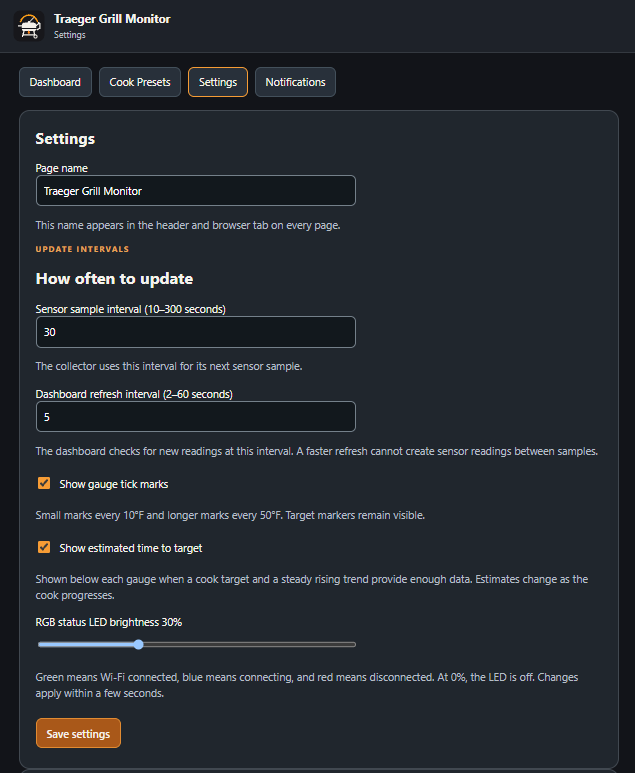
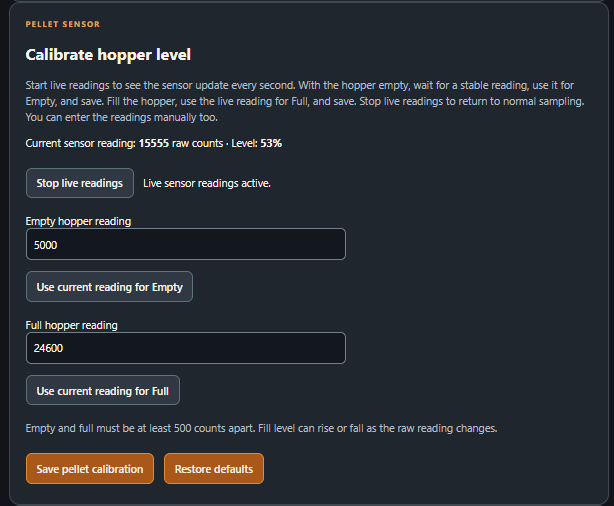
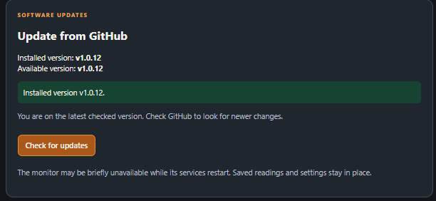
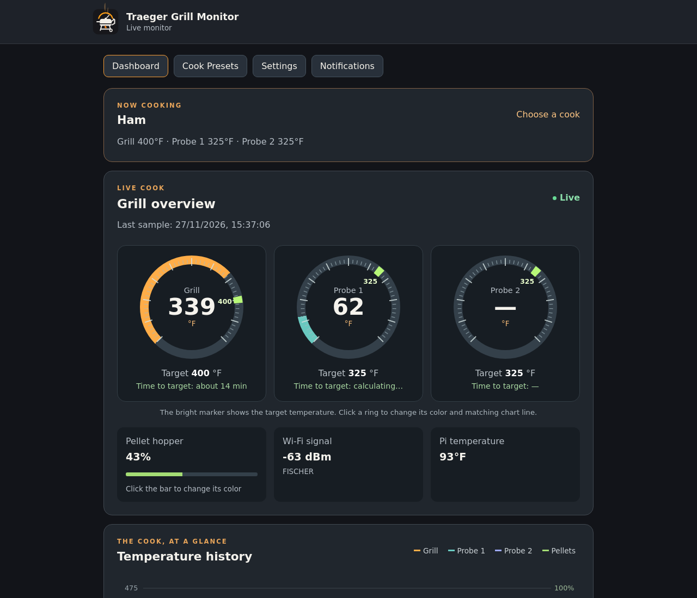

# Traeger Grill Monitor

A Raspberry Pi dashboard for a sensor-equipped Traeger grill. It shows grill and probe temperatures, a countdown beside the last sample for the next sensor reading, pellet level, Wi-Fi status, history, saved cook presets and Pushover alerts. **The monitor reads sensors; it does not control the grill.**

## Try the interactive demo

[Open the simulated Traeger Grill Monitor](https://rlf62.github.io/pellet-grill-monitor/demo/). It runs with sample readings in your browser. Try the cook presets, gauge tick marks, and estimated time-to-target controls without connecting to a grill or sending alerts.

## Settings

The dashboard flags a pellet reading outside the saved calibration range instead of presenting it as an empty hopper. When the hopper level has declined steadily for long enough, it also estimates hours of pellets remaining. The estimate disappears when the sensor is unavailable or the trend is unreliable.

**Cook Presets → View saved cook history** opens past sessions and lets you download each session's original readings as CSV. New sessions are saved when a cook starts and closed when it ends or restarts.

In **Notifications**, a new cook can send its name, current grill temperature, pellet level, and Wi-Fi signal as soon as a preset is activated. Routine alerts can be snoozed for 30 minutes, 1 hour, or 4 hours. Optional repeating Pushover alerts for grill deviation or low pellets continue until acknowledged or 30 minutes pass. Delivery status shows the last accepted or failed attempt. Automatic alerts remain off until explicitly enabled.

In **Settings → Backup**, download a ZIP of readings, saved cooks and cook history, calibration, and app preferences. It excludes Pushover credentials and session secrets; keep those separately when moving to another Pi.







Open **Settings** to change the page name shown in every header and browser tab, choose Fahrenheit or Celsius for the dashboard, chart, cook presets, and alerts, adjust the sensor sampling and dashboard refresh intervals, and switch gauge tick marks or time-to-target estimates on or off. In **Calibrate hopper level**, press **Start live readings** to see the raw sensor value update every second. Capture and save a stable reading with the hopper empty, then repeat when full. Press **Stop live readings** to return to normal sampling; each installation keeps its own values. On Pis fitted with the optional RGB status LED, Settings also has a brightness slider. Blue means connecting, green means Wi-Fi connected, and red means disconnected. The **Update from GitHub** section shows installed and available release versions. Choose **Check for updates**, then **Install update** when a new release is available. The dashboard may briefly disconnect while services restart; saved cooks, readings, and preferences remain in place.

## Estimated time to target

Turn on **Show estimated time to target** in Settings to display predictions beneath the gauges.

A recorded warmup example shows an estimate beneath the Grill gauge. It recalculates with each new sensor sample, so the predicted time can change. A probe with no useful rising trend shows “calculating” until enough readings arrive.



## One-line install

On **Raspberry Pi OS Lite 32-bit (Trixie 13 or newer)** with Python 3.12+ and matching ADS1115 hardware, run this as the normal Pi user:

```bash
sudo apt update && sudo apt install -y git && git clone https://github.com/RLF62/pellet-grill-monitor.git && sudo bash pellet-grill-monitor/install.sh --port-80
```

Open the URL printed at the end. Reboot first if the installer enables the ADC overlay. Omit `--port-80` to use port 8081 only. Add `--rgb-led` for a common-cathode LED wired red GPIO 17, green GPIO 27 and blue GPIO 22; it enables a brightness slider and may require a reboot. The bundled Apache config allows the `192.168.1.0/24` trusted LAN; review it for another subnet. The installer stops if an older PHP monitor or new service already exists. See [installation and hardware](docs/INSTALL.md) for details. The source repository is public. The dashboard itself is intended for the trusted LAN and has no public Internet login.

## Screens

| Page | Features |
| --- | --- |
| Dashboard | Gauges with target marks and optional time-to-target estimates, a next-reading countdown beside the last sample, Wi-Fi name, pellet level, matching trace colors, hover values and clickable legend. |
| Cook Presets | Save targets, activate a cook and start a fresh chart session without deleting old readings. |
| Notifications | Configure Pushover keys and individual alerts. |
| Settings | Change the page name, set sensor and browser update intervals, toggle gauge tick marks and time-to-target estimates, adjust an optional RGB status LED, calibrate empty and full hopper readings, and check GitHub for software updates. |

Read the illustrated [user guide](docs/USER_GUIDE.md). Estimates update with each new sensor sample. A gauge shows “calculating” until a rising trend is available, and the estimate may move as the grill or probe temperature changes.

## How it works

`collector.py` reads the ADS1115 and Pi and writes `data/readings.csv`. `app.py` serves the dashboard on port 8081, optionally behind Apache on port 80. `cook_presets.py` manages recipes and chart sessions. `notification_worker.py` handles alerts. The three systemd services start on boot. Calibration is specific to the original sensors and should be verified against trusted measurements on another grill.

Runtime files in `data/`, credentials and settings in `private/`, and the old rollback copy in `legacy_backup/` are excluded from Git. Back them up separately. The installer was exercised on a Pi Zero W running Raspberry Pi OS Trixie and Python 3.13. The original grill uses a custom external activity LED on GPIO 27 and a 400 kHz I²C bus; those site-specific boot settings are not added by the general installer. The new app does not read the previous PHP installation.


## Software updates

Open **Settings → Update from GitHub** and select **Check for updates**. The page shows the installed and available release versions. Select **Install update** when one is available. The updater accepts only a clean fast-forward from this repository's `main` branch. It installs Python requirements when they change, restarts the three monitor services, and reports the result on the page. If installation fails after the code changes, it restores the previous commit and restarts the services. Readings, cook presets, credentials and preferences are stored outside Git and remain in place.

An existing installation made before this feature needs one setup step from its checkout: `sudo bash deploy/install-updater.sh`. A fresh installation includes that step. If a local tracked file was edited, the update is blocked so those changes can be reviewed first.

For troubleshooting, refresh Settings after an install and inspect `journalctl -u traeger-update.service -n 80 --no-pager` on the Pi if the update reports a failure.

The displayed release number comes from `VERSION` in each commit. Bump it for each published release; the updater compares commits internally so it can still detect a newer commit when the number was not bumped.
