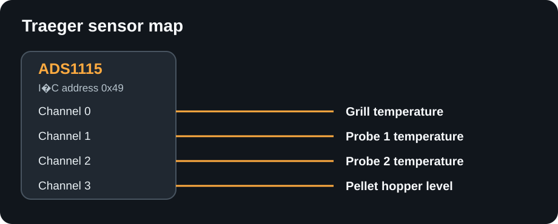

# Installation, hardware and recovery

[README](../README.md) · [User guide](USER_GUIDE.md)

The installer is for a **fresh Raspberry Pi OS Lite 32-bit (Trixie 13 or newer, Python 3.12+)** installation with the original monitor's ADS1115 sensor interface. It installs a Python virtual environment, local data folders, three systemd services, and optionally an Apache proxy. It does not supply probes, pellet hardware or a Pushover account. `collector.py` calibration matches the original Pi and must be checked on another grill.



| IIO ADC channel | Sensor |
| --- | --- |
| `in_voltage0_raw` | Grill thermistor |
| `in_voltage1_raw` | Probe 1 |
| `in_voltage2_raw` | Probe 2 |
| `in_voltage3_raw` | Pellet level |

The installer adds an ADS1115 overlay at I²C address `0x49` if the four channels are absent. Confirm I²C power and voltage, pin wiring, sensor types and calibration against a trusted thermometer before using readings or alerts.

## Fresh install

1. Prepare Raspberry Pi OS with network access and a regular account with `sudo`.
2. Install the public package in one line from the regular Pi account:

   ```bash
   sudo apt update && sudo apt install -y git && git clone https://github.com/RLF62/pellet-grill-monitor.git && sudo bash pellet-grill-monitor/install.sh --port-80
   ```

3. Reboot with `sudo reboot` if the installer requests it. Open the URL printed by the installer. Apache on port 80 admits loopback and `192.168.1.0/24`; change `deploy/apache-traeger.conf` for a different trusted subnet before installation. Omit `--port-80` to serve on port 8081 only.

Run `bash pellet-grill-monitor/install.sh --check --port-80` for model, folder and ADC preflight. The installer refuses to overwrite an existing monitor service, old PHP collector, occupied port 8081 or customized Apache site. Do not run two collectors. A fresh Pi Zero W installation on Trixie with Python 3.13 was completed and verified. The installer checks the OS and Python version before installing packages. The original grill also needs its site-specific `dtparam=i2c_arm_baudrate=400000` and `dtoverlay=act-led,gpio=27` boot settings; these are not added for other users.

## Verify

Run `sudo systemctl status traeger-collector traeger-monitor traeger-notifications` and `sudo journalctl -u traeger-collector -n 50 --no-pager`. Confirm the dashboard's last sample advances, temperatures match a trusted thermometer and pellet percentage is plausible. Configure Pushover in Notifications and send its test alert. Keep port 8081 within the trusted LAN; this package has no public Internet authentication.

## Existing PHP installations

Back up old PHP code, the old crontab, `data.txt`, `Cooking_Times.txt` and `Cooking_Times.tmp`. Stop the old collector and remove its boot task before enabling the new one. Migrate `data.txt` to `data/readings.csv` and copy the two cook files into `data/`, preserving timestamps with `cp -p`. Review calibration and file permissions. The automatic fresh installer intentionally stops when it sees an old PHP monitor; use a planned manual migration. On the original live Pi, its old app is a rollback copy only.

## Services, files and recovery

| Item | Purpose |
| --- | --- |
| `traeger-collector.service` | Sensor sampling to `data/readings.csv` |
| `traeger-monitor.service` | Gunicorn dashboard on port 8081 |
| `traeger-notifications.service` | Pushover alert evaluation |
| `private/update-settings.json` | Update intervals |
| `private/pushover.json` | Local secret keys; never commit |
| `data/Cooking_Times.txt`, `data/Cooking_Times.tmp` | Saved cook targets |

Back up `data/` and `private/` separately from Git before updates. Restart the dashboard with `sudo systemctl restart traeger-monitor`; inspect `journalctl -u traeger-monitor -n 50 --no-pager` if it fails. For rollback on the original Pi, stop the three new services first, then restore its prior collector crontab from its local `legacy_backup/` and start the PHP monitor. Never leave both collectors active against the same readings file.

