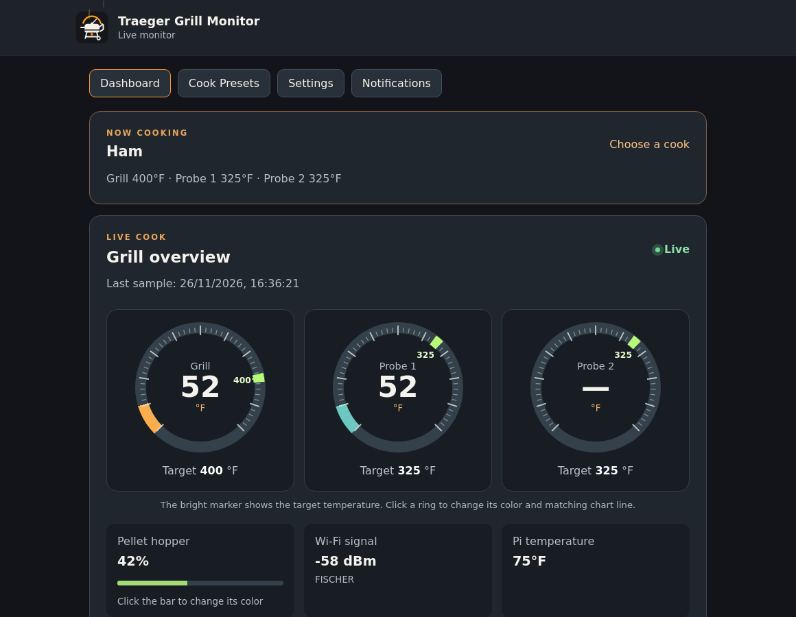
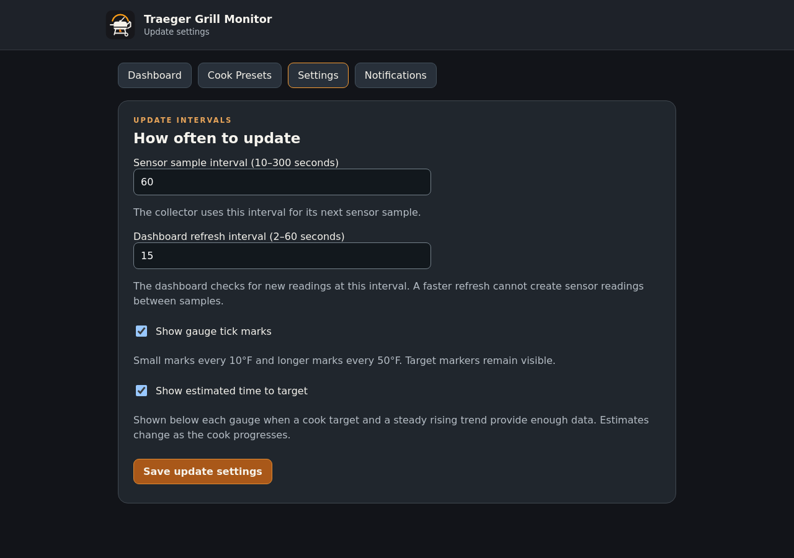

# User guide

[README](../README.md) � [Install and hardware](INSTALL.md)

## Dashboard

The dashboard shows the grill, two probes, pellet hopper, Pi temperature and Wi-Fi signal with its network name. A missing probe is shown as unavailable. Target marks on gauge rings show where saved temperature goals fall on the scale; they do not set the grill thermostat.

- Click a gauge ring to change its color and the matching chart trace. Click the colored line in the pellet hopper box to change its trace color.
- Hover a chart line, or tap near it, for the time, sensor name and value. Click a legend item to hide or show that trace. Pellet level has its own percentage scale.
- The active cook appears on the front page. Activating a preset starts a fresh chart session; older readings remain stored.

## Cook Presets

Open **Cook Presets** to save grill, Probe 1 and Probe 2 targets and a descriptive name. Leave a probe blank when unused. Edit or delete presets as recipes change. Activate one for the current cook; only one is active at a time. Stop the cook or activate another to end its current chart session. Verify safe food temperatures independently.

## Settings

Set the **sensor sample interval** to 10-300 seconds (default 60) and **dashboard refresh** to 2-60 seconds (default 15). A faster refresh does not create more sensor samples; the collector applies a changed interval after its current sleep. Toggle 10�F gauge tick marks (longer every 50�F) without hiding target marks.

## Notifications

Open **Notifications** to save a Pushover application token and user key, select individual alerts, and send a test message. The worker continues when the browser is closed. Credentials stay in the Pi's Git-ignored `private/` directory. Check alert thresholds and test delivery before relying on them.

## When readings stop

Check the last sample timestamp, then on the Pi run `sudo systemctl status traeger-collector traeger-monitor traeger-notifications` and `sudo journalctl -u traeger-collector -n 50 --no-pager`. Verify ADC channels and wiring with the [hardware guide](INSTALL.md). Reload the page if the browser itself is stale.

