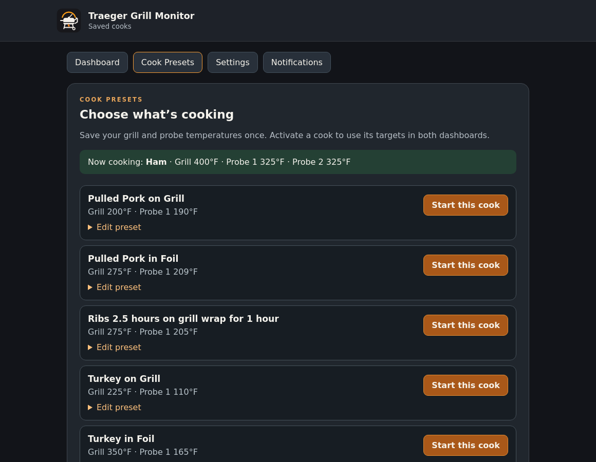
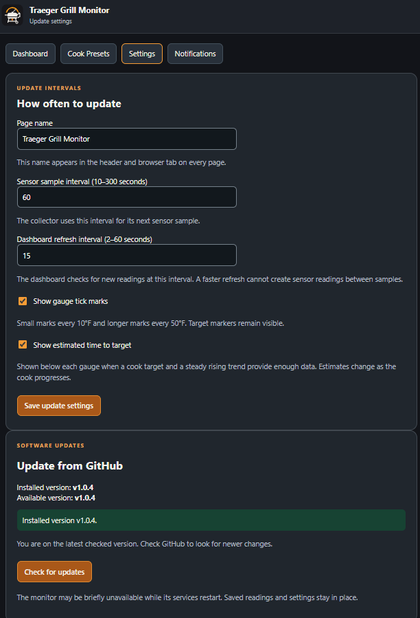

# User guide

[README](../README.md) · [Install and hardware](INSTALL.md)

## Dashboard

The dashboard shows the grill, two probes, pellet hopper, Pi temperature and Wi-Fi signal with its network name. A missing probe is shown as unavailable. Target marks on gauge rings show where saved temperature goals fall on the scale; they do not set the grill thermostat.

- Click a gauge ring to change its color and the matching chart trace. Click the colored line in the pellet hopper box to change its trace color.
- Hover a chart line, or tap near it, for the time, sensor name and value. Click a legend item to hide or show that trace. Pellet level has its own percentage scale.
- The active cook appears on the front page. Activating a preset starts a fresh chart session; older readings remain stored.
- Estimated time to target appears below each gauge when the current cook has a target and recent readings show a rising trend. The estimate recalculates with every new sensor sample and may change substantially during warmup. A moved probe begins a new trend; cooling or steady readings show “calculating” until there is a useful rise. A missing probe shows no estimate.

## Cook Presets

Open **Cook Presets** to save grill, Probe 1 and Probe 2 targets and a descriptive name. Leave a probe blank when unused. Edit or delete presets as recipes change. Activate one for the current cook; only one is active at a time. Stop the cook or activate another to end its current chart session. Verify safe food temperatures independently.

## Settings

Set **Page name** to the label you want in the page header and browser tab (up to 60 characters). Set the **sensor sample interval** to 10–300 seconds (default 60) and **dashboard refresh** to 2–60 seconds (default 15). A faster refresh does not create more sensor samples; the collector applies a changed interval after its current sleep. Toggle 10°F gauge tick marks (longer every 50°F) without hiding target marks. Uncheck **Show estimated time to target** to hide predictions.

For **Pellet sensor calibration**, empty the hopper, refresh Settings, choose **Use current reading for Empty**, and save. Fill the hopper, refresh Settings again, choose **Use current reading for Full**, and save. You may also type the raw counts. The two readings must differ by at least 500 counts; their order can be reversed for sensors whose signal decreases as the hopper fills. The defaults are 5000 empty and 24600 full. **Restore defaults** discards your calibration. A near-ground disconnected signal is shown as **Sensor unavailable** instead of an empty hopper when the sensor uses a rising signal. Check the physical pellet level independently until you have verified both endpoints.

On installations with the optional RGB status LED, the brightness slider controls all three colors: green for connected Wi-Fi, blue while connecting, and red when disconnected. Set it to 0% to turn the LED off.

In **Update from GitHub**, select **Check for updates** to compare installed and available versions. If a newer release appears, select **Install update** and refresh this page after the services restart. Saved settings, readings, and cook presets remain in place.

## Notifications

Open **Notifications** to save a Pushover application token and user key, select individual alerts, and send a test message. The worker continues when the browser is closed. Credentials stay in the Pi's Git-ignored `private/` directory. Check alert thresholds and test delivery before relying on them.

### Traeger notification icon

Download [the 72 × 72 PNG](../static/pushover-icon.png). On the Pushover website, open the application whose API token is entered in **Notifications**, choose **Edit**, and upload this image as its application icon. Send a test notification afterward. The app icon is managed by Pushover for that token; no icon setting is needed in the Pi's message sender.

## When readings stop

Check the last sample timestamp, then on the Pi run `sudo systemctl status traeger-collector traeger-monitor traeger-notifications` and `sudo journalctl -u traeger-collector -n 50 --no-pager`. Verify ADC channels and wiring with the [hardware guide](INSTALL.md). Reload the page if the browser itself is stale.

